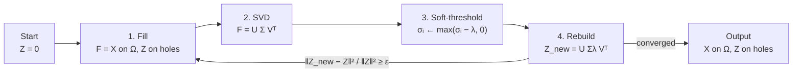

# Matrix Completion and Soft-Impute

> Matrix completion fills the holes of a partially observed matrix by assuming the full matrix is (close to) low rank. Soft-impute (Mazumder, Hastie & Tibshirani, 2010) does it with a four-step loop: fill the holes with the current guess, take an SVD, subtract $\lambda$ from every singular value, rebuild. Step 3 is Lasso's soft-threshold applied to singular values instead of regression weights, and the objective it solves is convex (nuclear norm penalty). ISLR's Algorithm 12.1 is the same loop with a hard rank cutoff instead ("hard-impute"). The worked examples use a 4x4 toy matrix (so every number can be followed by hand) and the Wine data (178 x 13), both offline.

![[soft_impute_stepper.gif]]

*The 4x4 example from the [[#The Algorithm Loop|loop section]], animated: first $\lambda=0.5$ (slow, nearly unbiased), then $\lambda=3$ (fast, biased low). Amber cells are holes, blue cells are observed entries that $Z$ no longer reproduces. The interactive version with $\lambda$ and iteration sliders is `_assets/soft-impute/soft_impute_stepper.html`: [open it in the browser](file:///C:/Vaults/ml-engineering-vault/ml-engineering-vault/_assets/soft-impute/soft_impute_stepper.html) (self-contained, works offline).*

### Quick Map

| Question | Short answer | Section |
|---|---|---|
| What is being minimized? | $\tfrac12\lVert P_\Omega(X-Z)\rVert_F^2+\lambda\lVert Z\rVert_*$ | [[#The Problem and Why Low Rank]] |
| Why subtract $\lambda$ from $\sigma$? | It is the exact prox of the nuclear norm | [[#Step 3 Is Exact - Singular Value Soft-Thresholding]] |
| Soft vs hard impute? | Shrink every $\sigma$ by $\lambda$ vs keep top $M$ unchanged | [[#Soft-Impute vs Hard-Impute (ISLR Algorithm 12.1)]] |
| When to stop? | $\lVert Z_{new}-Z\rVert^2/\lVert Z\rVert^2<\varepsilon$, never $\lVert Z_{new}-F\rVert$ | [[#Convergence and the Stopping Rule]] |
| Why are imputed values too small? | Shrinkage bias; debias or lower $\lambda$ | [[#Shrinkage Bias, Observed Cells, and Debiasing]] |
| How to pick $\lambda$ or $M$? | Hide 20% of observed cells, score them | [[#Choosing Lambda or Rank by Masked Validation]] |
| Small $\lambda$ takes forever? | Warm-start along a decreasing $\lambda$ path | [[#Warm Starts Along a Lambda Path]] |
| Centering, scaling, un-centering? | Standardize columns; broadcast stats back as `[None, :]` | [[#Preprocessing - Center, Scale, and Undo]] |

---

## The Problem and Why Low Rank

### Intuition

A matrix with holes has infinitely many completions; something has to rule most of them out. The assumption is that the full matrix is approximately low rank: every row is (close to) a combination of a few prototype rows. A ratings table works this way (a user's taste is a mix of a few genres), and so does a table of chemical measurements (a few latent factors such as cultivar drive all 13 columns). If the matrix has rank $r$, each missing cell must agree with the $r$ directions that the observed cells already pinned down.

Minimizing rank directly is NP-hard, for the same reason best-subset selection is: rank counts nonzero singular values, an $L_0$ count. The **nuclear norm** $\lVert Z\rVert_*=\sum_i\sigma_i$ is its convex relaxation, the $L_1$ norm of the singular-value vector. The relationship is exactly Lasso vs best subset ([[Lasso Regression]]), moved from regression weights to singular values.

### Formal Definition

Let $\Omega$ be the set of observed index pairs and $P_\Omega$ the projection that keeps observed cells and zeroes the rest:

$$
[P_\Omega(X)]_{ij}=\begin{cases}x_{ij}&(i,j)\in\Omega\\0&(i,j)\notin\Omega\end{cases}
\qquad
P_\Omega^\perp(Z)=Z-P_\Omega(Z)
$$

Soft-impute solves

$$
\hat Z_\lambda=\arg\min_{Z}\;\tfrac12\lVert P_\Omega(X-Z)\rVert_F^2+\lambda\lVert Z\rVert_*
$$

The first term only scores the observed cells; the second term is what decides the holes. $\lambda=0$ leaves the holes completely undetermined; $\lambda\ge\sigma_1$ gives $Z=0$.

### In Code

```python
"""
Why matrix completion can work at all: real tables are approximately LOW
RANK. 13 chemical measurements on 178 wines are driven by a few latent
factors (cultivar, ripeness, ...): 3 of 13 singular directions carry
two thirds of the energy, 5 carry 80%. Every missing cell then has to
be consistent with those few directions, and that constraint is what
pins its value down.
"""

from __future__ import annotations

import numpy as np
from sklearn.datasets import load_wine
from sklearn.preprocessing import StandardScaler

Xs = StandardScaler().fit_transform(load_wine().data)      # 178 x 13
s = np.linalg.svd(Xs, compute_uv=False)

energy = np.cumsum(s ** 2) / np.sum(s ** 2)
print("singular values:     ", np.round(s, 1))
print("cumulative energy:   ", np.round(energy, 3))

U, s, Vt = np.linalg.svd(Xs, full_matrices=False)
for k in (1, 2, 3, 5, 8):
    Xk = (U[:, :k] * s[:k]) @ Vt[:k]                         # best rank-k approximation (Eckart-Young)
    rel_err = np.linalg.norm(Xs - Xk) / np.linalg.norm(Xs)
    print(f"rank {k}: relative error {rel_err:.3f}, numbers stored {k * (178 + 13 - k):>5} of {Xs.size}")

# Nuclear norm vs rank: rank counts nonzero sigmas (L0), ||X||_* sums them (L1)
print(f"\nrank(Xs) = {np.linalg.matrix_rank(Xs)},  ||Xs||_* = {s.sum():.1f}")
```

```text
singular values:      [28.9 21.1 16.  12.8 12.3 10.7  9.9  7.9  7.2  6.7  6.3  5.5  4.3]
cumulative energy:    [0.362 0.554 0.665 0.736 0.802 0.851 0.893 0.92  0.942 0.962 0.979 0.992
 1.   ]
rank 1: relative error 0.799, numbers stored   190 of 2314
rank 2: relative error 0.668, numbers stored   378 of 2314
rank 3: relative error 0.579, numbers stored   564 of 2314
rank 5: relative error 0.445, numbers stored   930 of 2314
rank 8: relative error 0.283, numbers stored  1464 of 2314

rank(Xs) = 13,  ||Xs||_* = 149.6
```

### Common Misconceptions

- **"Low rank means the matrix has few nonzero entries."** Rank is about linear dependence between rows/columns, not sparsity. A dense rank-1 matrix like $uv^T$ has no zeros at all.
- **"The nuclear norm is the sum of absolute entries."** That is the elementwise $L_1$ norm. The nuclear norm sums singular values; it is invariant to rotations of rows and columns, the elementwise norm is not.
- **"Any missingness pattern works."** Completion needs every row and column to have some observed cells, and holes that are not driven by the hidden value itself (missing at random). A column observed only when it is large will be imputed too high, whatever the algorithm.

---

## Step 3 Is Exact - Singular Value Soft-Thresholding

### Intuition

With no holes, the soft-impute objective becomes $\tfrac12\lVert Z-F\rVert_F^2+\lambda\lVert Z\rVert_*$. Rotate into $F$'s singular basis: the Frobenius term splits into one term per singular value and the nuclear norm is already a sum over singular values, so the problem decouples into $p$ scalar Lasso problems $\min_{d\ge0}\tfrac12(d-\sigma_i)^2+\lambda d$. Each has the answer $d_i=\max(\sigma_i-\lambda,0)$. Directions with $\sigma_i\le\lambda$ (mostly noise) are deleted, which produces low rank; directions that survive all lose exactly $\lambda$, which produces bias.

### Formal Definition

Singular value thresholding (SVT), with $F=U\operatorname{diag}(\sigma)V^T$:

$$
S_\lambda(F)=U\operatorname{diag}\big(\max(\sigma_i-\lambda,0)\big)V^T=\arg\min_Z\tfrac12\lVert Z-F\rVert_F^2+\lambda\lVert Z\rVert_*
$$

So $S_\lambda$ is the proximal operator of $\lambda\lVert\cdot\rVert_*$, just as the scalar soft-threshold $\operatorname{sign}(\rho)\max(|\rho|-\lambda,0)$ is the prox of $\lambda|\cdot|$ in coordinate-descent Lasso. Compare with **hard thresholding** (truncated SVD, Eckart-Young): keep $\sigma_1..\sigma_M$ unchanged, zero the rest. That minimizes $\lVert Z-F\rVert_F$ under $\operatorname{rank}(Z)\le M$, a different, non-convex problem.

### In Code

```python
"""
Step 3 of soft-impute is not a heuristic: SVT (singular value thresholding)
  S_lam(F) = U diag(max(s - lam, 0)) V^T
is the EXACT minimizer of   0.5 * ||Z - F||_F^2 + lam * ||Z||_*
(the proximal operator of the nuclear norm). Checked numerically on the
standardized Wine matrix (178 x 13): no perturbation, and no hard
truncation to the same rank, achieves a lower objective.
"""

from __future__ import annotations

import numpy as np
from sklearn.datasets import load_wine
from sklearn.preprocessing import StandardScaler

F = StandardScaler().fit_transform(load_wine().data)
lam = 8.0


def nuclear_norm(Z: np.ndarray) -> float:
    return float(np.linalg.svd(Z, compute_uv=False).sum())


def objective(Z: np.ndarray) -> float:
    return 0.5 * float(np.sum((Z - F) ** 2)) + lam * nuclear_norm(Z)


def svt(A: np.ndarray, lam: float) -> np.ndarray:
    U, s, Vt = np.linalg.svd(A, full_matrices=False)
    return (U * np.maximum(s - lam, 0.0)) @ Vt


Z_soft = svt(F, lam)
U, s, Vt = np.linalg.svd(F, full_matrices=False)
r = int(np.count_nonzero(s > lam))
Z_hard = (U[:, :r] * s[:r]) @ Vt[:r]                       # Eckart-Young truncation, same rank

print("singular values of F: ", np.round(s, 2))
print(f"lambda = {lam}  ->  {r} survive the threshold")
print(f"objective(SVT)        = {objective(Z_soft):.3f}")
print(f"objective(hard rank-{r}) = {objective(Z_hard):.3f}   <- keeps full sigma, pays more nuclear norm")

rng = np.random.default_rng(0)
perturbed = [objective(Z_soft + 0.05 * rng.standard_normal(F.shape)) for _ in range(200)]
print(f"best of 200 random perturbations = {min(perturbed):.3f}  (never below SVT)")

# Same operator as Lasso's soft threshold, just applied to the singular-value vector
soft_threshold = lambda x, t: np.sign(x) * np.maximum(np.abs(x) - t, 0.0)
print("\nSVT == Lasso soft-threshold on sigma:",
      np.allclose(np.linalg.svd(Z_soft, compute_uv=False)[:r], soft_threshold(s, lam)[:r]))
```

```text
singular values of F:  [28.94 21.08 16.04 12.79 12.32 10.69  9.9   7.88  7.17  6.68  6.34  5.48
  4.29]
lambda = 8.0  ->  7 survive the threshold
objective(SVT)        = 793.552
objective(hard rank-7) = 1017.552   <- keeps full sigma, pays more nuclear norm
best of 200 random perturbations = 827.505  (never below SVT)

SVT == Lasso soft-threshold on sigma: True
```

### Common Misconceptions

- **"Soft-thresholding is truncated SVD with a fancier name."** Truncation keeps the surviving singular values intact; SVT shrinks them all by $\lambda$. Same subspace for the same number of survivors, different matrix, different objective.
- **"$\lambda$ is a rank."** $\lambda$ is in the units of singular values. The rank is an output: the count of $\sigma_i>\lambda$ at convergence. Because $\sigma$ grows with $\sqrt{np}$ and the data scale, a good $\lambda$ for one matrix means nothing for another; express it relative to $\sigma_1$ of the zero-filled matrix.

---

## The Algorithm Loop

### Intuition

You cannot apply SVT directly because the SVD needs a complete matrix. Soft-impute alternates: borrow the current guess for the holes, apply the exact solution to that complete problem, and repeat. Observed cells are re-imposed from $X$ every iteration, so the only cells that evolve are the holes. Each pass makes the holes a bit more consistent with the dominant singular directions; spurious singular values (created by the holes themselves) shrink below $\lambda$ and get cut.



### Formal Definition

```text
Z ← 0                                    # or column means; 0 if columns are centered
repeat:
    F ← P_Ω(X) + P_Ω⊥(Z)                 # 1. fill holes with current guess
    U, σ, Vᵀ ← svd(F)                    # 2. decompose
    σλ ← max(σ − λ, 0)                   # 3. soft-threshold (prox of nuclear norm)
    Z_new ← U · diag(σλ) · Vᵀ            # 4. rebuild
    if ‖Z_new − Z‖²_F / ‖Z‖²_F < ε: break
    Z ← Z_new
return P_Ω(X) + P_Ω⊥(Z)                  # keep the real observed values
```

Mazumder et al. prove the iterates converge to a global minimizer of the convex objective, and each iteration does not increase it (it is a majorize-minimize scheme: the fill step builds a surrogate that touches the objective at the current $Z$).

**Worked example.** $X=uv^T$ with $u=[1,2,3,4]$, $v=[2,1,3,2]$ (rank 1, $\sigma=[23.24,0,0,0]$), four holes:

```text
        c0   c1   c2   c3
r0  [   2    1    ?    2 ]    truth 3
r1  [   ?    2    6    4 ]    truth 4
r2  [   6    3    9    ? ]    truth 6
r3  [   8    ?   12    8 ]    truth 4
```

| $\lambda$ | iter | $\sigma(F)$ | after shrink | holes |
|---|---|---|---|---|
| 0.5 | 1 | 20.37, 5.40, 3.83, 2.05 | 19.87, 4.90, 3.33, 1.55 | 0.23, 0.29, 0.26, 0.21 |
| 0.5 | 10 | 21.69, 3.14, 1.51, 0.82 | 21.19, 2.64, 1.01, 0.32 | 2.35, 2.86, 2.59, 2.13 |
| 0.5 | 40 | 23.13, 0.19, 0.11, 0.09 | 22.63, 0, 0, 0 | 2.89, 3.90, 5.79, 3.84 |
| 3 | 1 | 20.37, 5.40, 3.83, 2.05 | 17.37, 2.40, 0.83, 0 | 1.04, 1.81, 1.58, 1.06 |
| 3 | 10 | 22.60, 1.07, 0.68, 0.52 | 19.60, 0, 0, 0 | 2.37, 3.37, 4.82, 3.08 |
| 10 | 40 | 21.45, 3.14, 2.14, 1.41 | 11.45, 0, 0, 0 | 1.13, 1.89, 2.54, 1.43 |

Read the table as three lessons. The zeros in the holes break the rank-1 structure, which is where $\sigma_2..\sigma_4$ come from at iteration 1. Small $\lambda$ gets close to the truth but crawls (holes move about 0.24 per iteration, rank 1 is only reached around iteration 21). Large $\lambda$ reaches rank 1 almost at once but every hole is biased toward 0.

### In Code

```python
"""
Soft-impute on a 4x4 rank-1 matrix, printed iteration by iteration.
This is the exact example behind the interactive stepper / GIF:
X = u v^T with u = [1,2,3,4], v = [2,1,3,2], four cells hidden.
"""

from __future__ import annotations

import numpy as np

X = np.outer([1.0, 2.0, 3.0, 4.0], [2.0, 1.0, 3.0, 2.0])
holes = [(0, 2), (1, 0), (2, 3), (3, 1)]
observed = np.ones_like(X, dtype=bool)
observed[tuple(zip(*holes))] = False
rows, cols = np.nonzero(~observed)

print("true singular values:", np.round(np.linalg.svd(X, compute_uv=False), 2))
print("truth in the holes:  ", X[rows, cols])


def soft_impute_trace(lam: float, n_iter: int) -> list[dict[str, np.ndarray]]:
    """Run soft-impute from Z = 0 and keep every intermediate quantity."""
    Z = np.zeros_like(X)
    trace = []
    for _ in range(n_iter):
        F = np.where(observed, X, Z)                     # 1. fill
        U, s, Vt = np.linalg.svd(F, full_matrices=False) # 2. SVD
        s_shrunk = np.maximum(s - lam, 0.0)              # 3. soft-threshold
        Z = (U * s_shrunk) @ Vt                          # 4. rebuild
        trace.append({"s": s, "s_shrunk": s_shrunk, "holes": Z[rows, cols].copy(), "Z": Z})
    return trace


for lam in (0.5, 3.0, 10.0):
    trace = soft_impute_trace(lam, n_iter=40)
    print(f"\nlambda = {lam}")
    for k in (0, 1, 9, 39):
        t = trace[k]
        print(f"  iter {k + 1:>2}: sigma={np.round(t['s'], 2)}  "
              f"shrunk={np.round(t['s_shrunk'], 2)}  holes={np.round(t['holes'], 2)}")
    Z = trace[-1]["Z"]
    print(f"  rank(Z) = {np.count_nonzero(trace[-1]['s_shrunk'])}, "
          f"max |Z - X| on OBSERVED cells = {np.abs(Z - X)[observed].max():.2f}")
```

```text
true singular values: [23.24  0.    0.    0.  ]
truth in the holes:   [3. 4. 6. 4.]

lambda = 0.5
  iter  1: sigma=[20.37  5.4   3.83  2.05]  shrunk=[19.87  4.9   3.33  1.55]  holes=[0.23 0.29 0.26 0.21]
  iter  2: sigma=[20.5   5.15  3.57  1.94]  shrunk=[20.    4.65  3.07  1.44]  holes=[0.47 0.58 0.51 0.42]
  iter 10: sigma=[21.69  3.14  1.51  0.82]  shrunk=[21.19  2.64  1.01  0.32]  holes=[2.35 2.86 2.59 2.13]
  iter 40: sigma=[23.13  0.19  0.11  0.09]  shrunk=[22.63  0.    0.    0.  ]  holes=[2.89 3.9  5.79 3.84]
  rank(Z) = 1, max |Z - X| on OBSERVED cells = 0.24

lambda = 3.0
  iter  1: sigma=[20.37  5.4   3.83  2.05]  shrunk=[17.37  2.4   0.83  0.  ]  holes=[1.04 1.81 1.58 1.06]
  iter  2: sigma=[21.17  3.91  2.27  1.51]  shrunk=[18.17  0.91  0.    0.  ]  holes=[1.74 2.99 3.13 1.96]
  iter 10: sigma=[22.6   1.07  0.68  0.52]  shrunk=[19.6  0.   0.   0. ]  holes=[2.37 3.37 4.82 3.08]
  iter 40: sigma=[22.6   1.07  0.68  0.51]  shrunk=[19.6  0.   0.   0. ]  holes=[2.37 3.37 4.82 3.09]
  rank(Z) = 1, max |Z - X| on OBSERVED cells = 1.50

lambda = 10.0
  iter  1: sigma=[20.37  5.4   3.83  2.05]  shrunk=[10.37  0.    0.    0.  ]  holes=[0.73 1.55 2.01 0.91]
  iter  2: sigma=[21.17  3.65  2.5   1.69]  shrunk=[11.17  0.    0.    0.  ]  holes=[1.   1.82 2.42 1.25]
  iter 10: sigma=[21.45  3.14  2.14  1.41]  shrunk=[11.45  0.    0.    0.  ]  holes=[1.13 1.89 2.54 1.43]
  iter 40: sigma=[21.45  3.14  2.14  1.41]  shrunk=[11.45  0.    0.    0.  ]  holes=[1.13 1.89 2.54 1.43]
  rank(Z) = 1, max |Z - X| on OBSERVED cells = 5.38
```

### Common Misconceptions

- **"$Z$ is the answer."** $Z$ is a low-rank approximation of the whole matrix, so it also changes the observed cells (by up to 5.38 at $\lambda=10$ above). Return $P_\Omega(X)+P_\Omega^\perp(Z)$: real values where you have them, $Z$ only in the holes.
- **"The starting fill matters a lot."** For soft-impute it does not affect the answer (convex objective, global minimizer); it only affects how many iterations you need. For hard-impute it can change the answer.
- **"Each iteration needs a full SVD."** For the small examples here, yes. At scale, the trick in the paper is that $F=P_\Omega(X-Z)+Z$ is "sparse + low rank", so a truncated SVD via matrix-vector products costs about $O(|\Omega|r+(n+p)r^2)$ per step, never forming $F$ densely.

---

## Soft-Impute vs Hard-Impute (ISLR Algorithm 12.1)

### Intuition

ISLR (2nd ed., §12.3, Algorithm 12.1, "Iterative Algorithm for Matrix Completion") runs the same loop but replaces step 3 with "keep the first $M$ principal components": a hard rank cutoff, no shrinkage. Footnote 5 of that section names it **Hard-Impute** and cites the soft-impute paper. ISLR starts from column means and stops when the observed-cell error (its eq. 12.14) fails to decrease; footnote 6 notes each iteration decreases that objective but a global optimum is not guaranteed.

The trade-off: hard-impute has no shrinkage bias, but nothing limits how hard the $M$ kept components chase noise in the observed cells, and the problem is non-convex. Soft-impute shrinks everything, which regularizes, and it is convex. On Wine below, hard-impute is best at $M=2..3$ and then degrades badly (worse than plain column means at $M\ge5$), while soft-impute can keep 12 or 13 components and still do well because each one is shrunk.

| | Soft-impute | Hard-impute (ISLR 12.1) |
|---|---|---|
| Step 3 | $\sigma_i\leftarrow\max(\sigma_i-\lambda,0)$ | keep $\sigma_1..\sigma_M$, zero the rest |
| Tuning knob | $\lambda$ (rank comes out) | $M$ (rank put in) |
| Objective | convex, global optimum | non-convex, depends on start |
| Bias | shrinks every survivor by $\lambda$ | none on survivors |
| Overfitting control | shrinkage | only the choice of $M$ |

### Formal Definition

Hard-impute targets

$$
\min_{\operatorname{rank}(Z)\le M}\;\lVert P_\Omega(X-Z)\rVert_F^2
\quad\Longleftrightarrow\quad
\min_{A\in\mathbb R^{n\times M},\,B\in\mathbb R^{p\times M}}\sum_{(i,j)\in\Omega}\Big(x_{ij}-\sum_{m=1}^M a_{im}b_{jm}\Big)^2
$$

(the right-hand form is ISLR eq. 12.12, with $A$ playing the role of scores and $B$ of loadings). Its step 3 is $\sigma_i\leftarrow\sigma_i\,\mathbb 1[i\le M]$.

### In Code

```python
"""
Soft-impute vs hard-impute (ISLR Algorithm 12.1) vs column-mean imputation
on the Wine data with 10% of the cells knocked out at random.

Both iterative methods share the same loop; they differ only in step 3:
  soft: sigma <- max(sigma - lam, 0)      (convex, shrinks every survivor)
  hard: keep top-M sigma unchanged, zero the rest   (non-convex, no shrinkage)
"""

from __future__ import annotations

import numpy as np
from sklearn.datasets import load_wine
from sklearn.preprocessing import StandardScaler

rng = np.random.default_rng(0)
X_true = load_wine().data
n, p = X_true.shape

holes = rng.random(X_true.shape) < 0.10                 # 10% missing, like ISLR's USArrests demo
X_missing = np.where(holes, np.nan, X_true)

# StandardScaler ignores NaN in fit and keeps NaN in transform:
# means/stds come from OBSERVED cells only.
scaler = StandardScaler().fit(X_missing)
Xs = scaler.transform(X_missing)
observed = ~np.isnan(Xs)


def soft_impute(Xs: np.ndarray, lam: float, max_iter: int = 500, tol: float = 1e-5,
                Z0: np.ndarray | None = None) -> tuple[np.ndarray, int]:
    observed = ~np.isnan(Xs)
    Z = np.zeros_like(Xs) if Z0 is None else Z0
    for it in range(1, max_iter + 1):
        F = np.where(observed, Xs, Z)
        U, s, Vt = np.linalg.svd(F, full_matrices=False)
        Z_new = (U * np.maximum(s - lam, 0.0)) @ Vt
        change = np.sum((Z_new - Z) ** 2) / max(np.sum(Z ** 2), 1e-12)
        Z = Z_new
        if change < tol:
            break
    return Z, it


def hard_impute(Xs: np.ndarray, rank: int, max_iter: int = 500, tol: float = 1e-5) -> tuple[np.ndarray, int]:
    observed = ~np.isnan(Xs)
    Z = np.zeros_like(Xs)                                # 0 = column mean after standardizing
    for it in range(1, max_iter + 1):
        F = np.where(observed, Xs, Z)
        U, s, Vt = np.linalg.svd(F, full_matrices=False)
        Z_new = (U[:, :rank] * s[:rank]) @ Vt[:rank]
        change = np.sum((Z_new - Z) ** 2) / max(np.sum(Z ** 2), 1e-12)
        Z = Z_new
        if change < tol:
            break
    return Z, it


def score(Z: np.ndarray) -> tuple[float, float]:
    """RMSE (in standardized units) and Pearson r, on the hidden cells only."""
    truth = scaler.transform(X_true)[holes]
    pred = Z[holes]
    return float(np.sqrt(np.mean((pred - truth) ** 2))), float(np.corrcoef(pred, truth)[0, 1])


print(f"{holes.sum()} hidden cells out of {holes.size}")
print(f"{'method':<22}{'iters':>6}{'rank':>6}{'RMSE':>8}{'r':>8}")
rmse0 = float(np.sqrt(np.mean(scaler.transform(X_true)[holes] ** 2)))
print(f"{'column mean':<22}{'-':>6}{'-':>6}{rmse0:>8.3f}{'-':>8}")
for M in (1, 2, 3, 5, 8):
    Z, it = hard_impute(Xs, M)
    print(f"{f'hard-impute M={M}':<22}{it:>6}{M:>6}{score(Z)[0]:>8.3f}{score(Z)[1]:>8.3f}")
for lam in (2.0, 5.0, 10.0, 20.0):
    Z, it = soft_impute(Xs, lam)
    rank = int(np.sum(np.linalg.svd(Z, compute_uv=False) > 1e-8))
    print(f"{f'soft-impute lam={lam:g}':<22}{it:>6}{rank:>6}{score(Z)[0]:>8.3f}{score(Z)[1]:>8.3f}")
```

```text
249 hidden cells out of 2314
method                 iters  rank    RMSE       r
column mean                -     -   1.078       -
hard-impute M=1            6     1   0.923   0.518
hard-impute M=2            7     2   0.826   0.645
hard-impute M=3            9     3   0.831   0.646
hard-impute M=5           31     5   1.150   0.457
hard-impute M=8           45     8   1.372   0.411
soft-impute lam=2         14    13   0.827   0.692
soft-impute lam=5          8    12   0.821   0.693
soft-impute lam=10         5     6   0.878   0.668
soft-impute lam=20         4     1   1.024   0.513
```

Correlation between imputed and true values is the metric ISLR reports (0.63 average for USArrests with $M=1$); RMSE in standardized units is easier to compare across datasets because predicting the column mean scores about 1.

### Common Misconceptions

- **"Hard-impute is wrong."** It is a perfectly good method when $M$ is chosen by validation, and it is unbiased. Its failure mode is choosing $M$ too large; soft-impute's failure mode is choosing $\lambda$ too large.
- **"More components always fit better."** On the observed cells, yes. On the holes, past a point every extra component is fitting noise (see the validation section).

---

## Convergence and the Stopping Rule

### Intuition

Two quantities look like natural convergence checks and only one of them is. $\lVert Z_{new}-Z\rVert$ measures whether the iterate stopped moving, which is the definition of reaching a fixed point. $\lVert Z_{new}-F\rVert$ measures how far the shrunken matrix sits from the filled matrix, and that never reaches zero: on the observed cells $F$ holds the real data while $Z_{new}$ is shrunk, so the gap is the training residual plus the shrinkage, a quantity set by your choice of $\lambda$.

### Formal Definition

From the SVD of $F$,

$$
F-S_\lambda(F)=U\operatorname{diag}\big(\sigma_i-\max(\sigma_i-\lambda,0)\big)V^T=U\operatorname{diag}\big(\min(\sigma_i,\lambda)\big)V^T
$$

$$
\lVert F-Z_{new}\rVert_F^2=\sum_i\min(\sigma_i,\lambda)^2\;\ge\;r\lambda^2
$$

with $r$ the number of surviving components. At the fixed point $Z^*$, the holes of $F$ equal $Z^*$, so $\lVert F-Z^*\rVert_F^2=\lVert P_\Omega(X-Z^*)\rVert_F^2$: the data-fit term of the objective, not a convergence measure. Use

$$
\frac{\lVert Z_{new}-Z\rVert_F^2}{\lVert Z\rVert_F^2}<\varepsilon
$$

(the criterion in Mazumder et al.), or the relative change of the full objective between iterations. Also: compute RMSE as `np.sqrt(np.mean((a - b) ** 2))`. Writing `np.mean(a - b) ** 2` squares the mean, so positive and negative differences cancel and the "error" can be near 0 while the iterate is still moving.

### In Code

```python
"""
Which quantity tells you soft-impute has converged?
  ||Z_new - Z||^2 / ||Z||^2   -> 0     (the iterate stops moving)
  ||Z_new - F||^2 / ||F||^2   -> floor (never 0 for lam > 0)
The floor is exact: F - S_lam(F) = U diag(min(sigma, lam)) V^T, so
  ||F - Z_new||_F^2 = sum_i min(sigma_i, lam)^2  >= r * lam^2.
"""

from __future__ import annotations

import numpy as np
from sklearn.datasets import load_wine
from sklearn.preprocessing import StandardScaler

rng = np.random.default_rng(0)
X_true = load_wine().data
X_missing = np.where(rng.random(X_true.shape) < 0.10, np.nan, X_true)
Xs = StandardScaler().fit(X_missing).transform(X_missing)
observed = ~np.isnan(Xs)
lam = 5.0

Z = np.zeros_like(Xs)
print(f"{'iter':>4}  {'||Zn-Z||^2/||Z||^2':>20}  {'||Zn-F||^2/||F||^2':>20}  {'sum min(s,lam)^2':>17}  {'||Zn-F||^2':>11}")
for it in range(1, 41):
    F = np.where(observed, Xs, Z)
    U, s, Vt = np.linalg.svd(F, full_matrices=False)
    Z_new = (U * np.maximum(s - lam, 0.0)) @ Vt
    move = np.sum((Z_new - Z) ** 2) / np.sum(Z ** 2) if it > 1 else np.inf   # Z = 0 at iter 1
    gap = np.sum((Z_new - F) ** 2)
    floor = np.sum(np.minimum(s, lam) ** 2)
    if it in (1, 2, 5, 10, 20, 40):
        print(f"{it:>4}  {move:>20.2e}  {gap / np.sum(F ** 2):>20.4f}  {floor:>17.2f}  {gap:>11.2f}")
    Z = Z_new

r = int(np.count_nonzero(s > lam))
print(f"\nsurviving components r = {r};  r * lam^2 = {r * lam ** 2:.0f}  <= ||Zn - F||^2")
print("A test like '||Zn - F||^2/||F||^2 < 1e-5' would run until max_iter.")
```

```text
iter    ||Zn-Z||^2/||Z||^2    ||Zn-F||^2/||F||^2   sum min(s,lam)^2   ||Zn-F||^2
   1                   inf                0.1572             324.62       324.62
   2              5.22e-03                0.1529             317.76       317.76
   5              1.33e-04                0.1496             316.36       316.36
  10              4.92e-07                0.1489             316.30       316.30
  20              2.46e-11                0.1489             316.30       316.30
  40              7.27e-19                0.1489             316.30       316.30

surviving components r = 12;  r * lam^2 = 300  <= ||Zn - F||^2
A test like '||Zn - F||^2/||F||^2 < 1e-5' would run until max_iter.
```

### Common Misconceptions

- **"A fixed iteration count is fine."** It is fine only if you check the change at the last iteration. At small $\lambda$ 20 iterations can be nowhere near converged (the 4x4 example needs about 25 at $\lambda=0.5$).
- **"Relative change below tol means converged."** Usually. When steps are tiny but persistent (small $\lambda$, cold start) the test can pass early; see the warm-start section for a measured case.

---

## Shrinkage Bias, Observed Cells, and Debiasing

### Intuition

Every surviving singular value loses $\lambda$, so the low-rank fit is pulled toward zero, which after centering means toward the column means. Two consequences. First, the observed cells of $Z$ disagree with $X$ (the blue cells in the GIF), so the returned matrix must put $X$ back on $\Omega$. Second, the imputed values are biased low in magnitude. Soft-impute is good at finding the right subspace and systematically too timid about how far along it to go.

The fix from the paper's post-processing step: keep the subspace ($U_r$, $V_r$) and refit only the $r$ singular values by unpenalized least squares on the observed cells. It is the matrix version of "Lasso for selection, then OLS on the selected features" (the relaxed Lasso).

### Formal Definition

$$
\hat d=\arg\min_{d\in\mathbb R^r}\sum_{(i,j)\in\Omega}\Big(x_{ij}-\sum_{k=1}^r d_k\,u_{ik}v_{jk}\Big)^2,
\qquad
\hat Z_{debiased}=U_r\operatorname{diag}(\hat d)V_r^T
$$

An ordinary least-squares problem with $r$ unknowns: design column $k$ is $u_{ik}v_{jk}$ evaluated at each observed $(i,j)$.

### In Code

```python
"""
Soft-impute picks the right SUBSPACE but shrinks every kept sigma by lambda,
so imputed values are biased toward 0 (toward the column mean).
Fix ("debiasing", the post-processing step in Mazumder et al. 2010): keep the
singular vectors U_r, V_r and refit only the r singular values by least
squares on the OBSERVED cells:
    min_d  sum_{(i,j) observed} ( x_ij - sum_k d_k u_ik v_jk )^2
That is an ordinary r-column regression: column k of the design matrix is
u_ik * v_jk evaluated at every observed (i, j).
"""

from __future__ import annotations

import numpy as np
from sklearn.datasets import load_wine
from sklearn.preprocessing import StandardScaler


def soft_impute(Xs: np.ndarray, lam: float, max_iter: int = 2000, tol: float = 1e-9) -> np.ndarray:
    observed = ~np.isnan(Xs)
    Z = np.zeros_like(Xs)
    for _ in range(max_iter):
        U, s, Vt = np.linalg.svd(np.where(observed, Xs, Z), full_matrices=False)
        Z_new = (U * np.maximum(s - lam, 0.0)) @ Vt
        done = np.sum((Z_new - Z) ** 2) < tol * max(np.sum(Z ** 2), 1e-12)
        Z = Z_new
        if done:
            break
    return Z


def debias(Xs: np.ndarray, Z: np.ndarray) -> np.ndarray:
    U, s, Vt = np.linalg.svd(Z, full_matrices=False)
    r = int(np.sum(s > 1e-8 * s[0]))
    i, j = np.nonzero(~np.isnan(Xs))
    design = U[i, :r] * Vt[:r, j].T                      # (n_observed, r)
    d, *_ = np.linalg.lstsq(design, Xs[i, j], rcond=None)
    return (U[:, :r] * d) @ Vt[:r]


# --- 1. The 4x4 rank-1 toy: debiasing recovers most of the shrinkage -------
# (not all: U_r, V_r were themselves estimated from shrunken fills)
X = np.outer([1.0, 2.0, 3.0, 4.0], [2.0, 1.0, 3.0, 2.0])
toy = X.copy()
toy[[0, 1, 2, 3], [2, 0, 3, 1]] = np.nan
Z = soft_impute(toy, lam=3.0)
holes = np.isnan(toy)
print("toy truth      :", X[holes])
print("soft, lam = 3  :", np.round(Z[holes], 2))
print("soft + debias  :", np.round(debias(toy, Z)[holes], 2))

# --- 2. Wine, validation cells hidden, standardized on training cells ---
rng = np.random.default_rng(0)
X_true = load_wine().data
X_missing = np.where(rng.random(X_true.shape) < 0.10, np.nan, X_true)
obs_idx = np.flatnonzero(~np.isnan(X_missing))
val_idx = rng.choice(obs_idx, size=int(0.2 * obs_idx.size), replace=False)
X_train = X_missing.copy()
X_train.flat[val_idx] = np.nan
scaler = StandardScaler().fit(X_train)
Xs = scaler.transform(X_train)
y_val = scaler.transform(X_missing).flat[val_idx]

rmse = lambda Z: float(np.sqrt(np.mean((Z.flat[val_idx] - y_val) ** 2)))
print(f"\n{'lambda':>7} {'rank':>5} {'soft val':>9} {'debiased val':>13}")
for lam in (4.0, 8.0, 12.0, 20.0):
    Z = soft_impute(Xs, lam)
    rank = int(np.sum(np.linalg.svd(Z, compute_uv=False) > 1e-8))
    print(f"{lam:>7g} {rank:>5} {rmse(Z):>9.3f} {rmse(debias(Xs, Z)):>13.3f}")
```

```text
toy truth      : [3. 4. 6. 4.]
soft, lam = 3  : [2.37 3.37 4.82 3.09]
soft + debias  : [2.79 3.96 5.67 3.63]

 lambda  rank  soft val  debiased val
      4    12     0.817         0.815
      8     6     0.859         0.794
     12     3     0.934         0.811
     20     1     1.046         0.927
```

Debiasing helps most where shrinkage is heaviest (large $\lambda$, few components) and turns $\lambda=8$ into the best model in this run. It cannot fully undo the toy's bias because the subspace itself was estimated from shrunken fills.

### Common Misconceptions

- **"Bias means the method is broken."** The bias is the price of the variance reduction; at moderate $\lambda$ it is the better trade (lower validation error than hard-impute at any rank above). Debiasing just tries to get some of the bias back once the subspace is chosen.
- **"Clip predictions to the valid range and you are done."** Clipping (for example ratings to [1, 5]) is a sensible last step, but it does not touch shrinkage bias inside the range.

---

## Choosing Lambda or Rank by Masked Validation

### Intuition

There is no held-out target column, so make one: hide a random 20% of the observed cells, complete, and score the hidden ones. This is the validation-set approach (ISLR mentions it at the end of §12.3), applied to cells instead of rows. Training error falls monotonically with model size; validation error is U-shaped. When the curve's minimum sits at rank 1, that is usually not a bug: count the parameters. A rank-$M$ fit of an $n\times p$ matrix has $M(n+p-M)$ free parameters, and when observed cells per parameter drop toward 2 or 1, each row's factors are fitted to a handful of its own entries.

### Formal Definition

Split $\Omega=\Omega_{train}\cup\Omega_{val}$ at random. For each candidate $\theta$ ($\lambda$ or $M$):

$$
\text{val}(\theta)=\sqrt{\frac1{|\Omega_{val}|}\sum_{(i,j)\in\Omega_{val}}\big(x_{ij}-\hat z^{(\theta)}_{ij}\big)^2},
\qquad \hat\theta=\arg\min_\theta \text{val}(\theta)
$$

where $\hat Z^{(\theta)}$ is fitted on $\Omega_{train}$ only. Any preprocessing statistic (column means, standard deviations) must also be computed from $\Omega_{train}$ only; otherwise the validation cells leak into the fit through the centering.

### In Code

```python
"""
Picking M (hard-impute) or lambda (soft-impute) by masked validation.
  1. hide 20% of the OBSERVED cells as a validation set
  2. fit the scaler on what is left (no leakage from validation cells)
  3. complete, score RMSE on the hidden validation cells
Train RMSE always falls with model size; validation RMSE tells the truth.
"""

from __future__ import annotations

import numpy as np
from sklearn.datasets import load_wine
from sklearn.preprocessing import StandardScaler

rng = np.random.default_rng(0)
X_true = load_wine().data
n, p = X_true.shape
X_missing = np.where(rng.random(X_true.shape) < 0.10, np.nan, X_true)   # the data we "have"

obs_idx = np.flatnonzero(~np.isnan(X_missing))
val_idx = rng.choice(obs_idx, size=int(0.2 * obs_idx.size), replace=False)
train_idx = np.setdiff1d(obs_idx, val_idx, assume_unique=True)

X_train = X_missing.copy()
X_train.flat[val_idx] = np.nan
scaler = StandardScaler().fit(X_train)          # statistics from training cells only
Xs = scaler.transform(X_train)
observed = ~np.isnan(Xs)
y_val = scaler.transform(X_missing).flat[val_idx]
y_train = Xs.flat[train_idx]


def complete(Xs: np.ndarray, shrink, max_iter: int = 500, tol: float = 1e-5) -> np.ndarray:
    """Generic fill/SVD/shrink/rebuild loop; `shrink` maps sigma -> new sigma."""
    observed = ~np.isnan(Xs)
    Z = np.zeros_like(Xs)
    for _ in range(max_iter):
        U, s, Vt = np.linalg.svd(np.where(observed, Xs, Z), full_matrices=False)
        Z_new = (U * shrink(s)) @ Vt
        done = np.sum((Z_new - Z) ** 2) < tol * max(np.sum(Z ** 2), 1e-12)
        Z = Z_new
        if done:
            break
    return Z


def rmse(a: np.ndarray, b: np.ndarray) -> float:
    return float(np.sqrt(np.mean((a - b) ** 2)))


print(f"training cells = {train_idx.size}, validation cells = {val_idx.size}")
print(f"baseline (predict column mean = 0): val RMSE = {rmse(0.0, y_val):.3f}\n")

print(f"{'hard M':>6} {'params':>7} {'cells/param':>12} {'train':>7} {'val':>7}")
for M in (1, 2, 3, 4, 6, 9):
    Z = complete(Xs, lambda s, M=M: np.where(np.arange(s.size) < M, s, 0.0))
    params = M * (n + p - M)
    print(f"{M:>6} {params:>7} {train_idx.size / params:>12.1f} "
          f"{rmse(Z.flat[train_idx], y_train):>7.3f} {rmse(Z.flat[val_idx], y_val):>7.3f}")

print(f"\n{'soft lam':>8} {'rank':>5} {'train':>7} {'val':>7}")
results = {}
for lam in (1.0, 2.0, 4.0, 6.0, 8.0, 12.0, 20.0):
    Z = complete(Xs, lambda s, lam=lam: np.maximum(s - lam, 0.0))
    results[lam] = rmse(Z.flat[val_idx], y_val)
    rank = int(np.sum(np.linalg.svd(Z, compute_uv=False) > 1e-8))
    print(f"{lam:>8g} {rank:>5} {rmse(Z.flat[train_idx], y_train):>7.3f} {results[lam]:>7.3f}")

best = min(results, key=results.get)
print(f"\nbest lambda = {best:g} (val RMSE {results[best]:.3f})")
```

```text
training cells = 1652, validation cells = 413
baseline (predict column mean = 0): val RMSE = 1.066

hard M  params  cells/param   train     val
     1     190          8.7   0.787   0.944
     2     378          4.4   0.641   0.887
     3     564          2.9   0.544   0.864
     4     748          2.2   0.451   0.958
     6    1110          1.5   0.291   1.537
     9    1638          1.0   0.109   1.278

soft lam  rank   train     val
       1    13   0.089   0.836
       2    13   0.177   0.825
       4    12   0.352   0.820
       6     9   0.508   0.828
       8     6   0.637   0.860
      12     3   0.800   0.934
      20     1   0.972   1.046

best lambda = 4 (val RMSE 0.820)
```

### Common Misconceptions

- **"One random split is enough."** One split is a noisy estimate, especially for hard-impute whose non-convexity adds start-point noise. If two candidates are close, repeat over several seeds and average.
- **"Use the same random mask for each candidate? That's cheating."** It is the opposite: a fixed mask makes candidates differ only by the model, not by which cells they were scored on.
- **"Validation picked rank 1, so the data is one-dimensional."** It means the data cannot support estimating more than one component reliably at this sparsity and noise level. More observed cells or a shrinkage method (soft-impute) can support more.

---

## Warm Starts Along a Lambda Path

### Intuition

Small $\lambda$ means small steps: the holes creep, and convergence from $Z=0$ takes many SVDs. Solutions for neighbouring $\lambda$ values are close, so fit a decreasing grid from $\lambda\approx\sigma_1$ (where $Z=0$) downward and start each fit from the previous solution. This is the same pathwise strategy as `lasso_path` / `LassoCV`. You get the whole regularization path, which is what masked validation needs anyway.

The measured surprise below: warm starts are more accurate as well as cheaper. A cold start at small $\lambda$ takes tiny persistent steps and trips the relative-change test long before the fixed point; a warm start begins close to it.

### Formal Definition

Grid $\lambda_1>\lambda_2>\dots>\lambda_K$ with $\lambda_1=\sigma_1(P_\Omega(X))$. For $k=1..K$: run soft-impute at $\lambda_k$ initialized at $\hat Z_{\lambda_{k-1}}$ (with $\hat Z_{\lambda_0}=0$).

### In Code

```python
"""
Small lambda converges slowly from Z = 0 (the 4x4 stepper shows the holes
creeping up ~0.24 per iteration at lambda = 0.5). Mazumder, Hastie &
Tibshirani (2010) fit a DECREASING lambda grid and warm-start each fit from
the previous solution; neighbouring solutions are close, so each fit needs
only a few iterations.

The surprise: warm starts are not only cheaper, they are MORE accurate.
At small lambda each step is tiny, so a cold start trips the relative-change
test long before it reaches the fixed point (false convergence). A warm
start begins next to the answer. 'gap' = max |Z - Z_ref| where Z_ref is the
same fit run to tol = 1e-14.
"""

from __future__ import annotations

import numpy as np
from sklearn.datasets import load_wine
from sklearn.preprocessing import StandardScaler

rng = np.random.default_rng(0)
X_true = load_wine().data
X_missing = np.where(rng.random(X_true.shape) < 0.10, np.nan, X_true)
Xs = StandardScaler().fit(X_missing).transform(X_missing)
observed = ~np.isnan(Xs)


def soft_impute(lam: float, Z0: np.ndarray, max_iter: int = 2000, tol: float = 1e-7) -> tuple[np.ndarray, int]:
    Z = Z0
    for it in range(1, max_iter + 1):
        U, s, Vt = np.linalg.svd(np.where(observed, Xs, Z), full_matrices=False)
        Z_new = (U * np.maximum(s - lam, 0.0)) @ Vt
        done = np.sum((Z_new - Z) ** 2) < tol * max(np.sum(Z ** 2), 1e-12)
        Z = Z_new
        if done:
            return Z, it
    return Z, max_iter


s_max = np.linalg.svd(np.where(observed, Xs, 0.0), compute_uv=False)[0]
lambdas = s_max * np.geomspace(1.0, 0.005, 12)          # lam >= s_max gives Z = 0

cold_total = warm_total = 0
Z_warm = np.zeros_like(Xs)
print(f"{'lambda':>8} {'cold iters':>11} {'cold gap':>9} {'warm iters':>11} {'warm gap':>9}")
for lam in lambdas:
    Z_cold, it_cold = soft_impute(lam, np.zeros_like(Xs))
    Z_warm, it_warm = soft_impute(lam, Z_warm)
    Z_ref, _ = soft_impute(lam, Z_warm, max_iter=20_000, tol=1e-14)
    cold_total += it_cold
    warm_total += it_warm
    print(f"{lam:>8.3f} {it_cold:>11} {np.abs(Z_cold - Z_ref).max():>9.1e} "
          f"{it_warm:>11} {np.abs(Z_warm - Z_ref).max():>9.1e}")
print(f"\ntotal SVDs: cold = {cold_total}, warm = {warm_total}")
```

```text
  lambda  cold iters  cold gap  warm iters  warm gap
  26.279           1   0.0e+00           1   0.0e+00
  16.234           5   1.7e-04           5   1.7e-04
  10.028           7   5.4e-04           6   6.3e-04
   6.195          10   1.8e-03           8   2.0e-03
   3.827          15   6.4e-03           8   7.6e-03
   2.364          22   1.6e-02           2   4.9e-03
   1.460          32   3.0e-02           2   3.8e-03
   0.902          46   5.2e-02           2   3.2e-03
   0.557          65   8.6e-02           2   2.9e-03
   0.344          90   1.4e-01           2   2.7e-03
   0.213         120   2.2e-01           2   2.6e-03
   0.131         155   3.4e-01           2   2.5e-03

total SVDs: cold = 568, warm = 42
```

### Common Misconceptions

- **"Warm starts change the answer."** For a convex problem the minimizer at each $\lambda$ is unique; the start only changes how fast (and, with a finite tolerance, how closely) you reach it.

---

## Preprocessing - Center, Scale, and Undo

### Intuition

The SVD minimizes squared error, so units matter exactly as in PCA ([[Principal Component Analysis#Raw vs. Standardized: Why Scale Changes the Answer]]). In Wine, proline has a standard deviation around 307 and hue around 0.23; on a matrix that is only centered, the top two singular directions are literally the proline and magnesium columns, and a $\lambda$ that is meaningful for them erases the structure among the small-unit columns. Standardize columns first (statistics from observed cells only), complete, then undo. After centering, a 0 in the holes is the column mean, which is why $Z=0$ is the natural start.

Undoing is broadcasting: column statistics have shape `(p,)` and must be applied along rows, i.e. as `(1, p)`. `stats[None, :]` (or plain `stats`) is right; `stats[:, None]` is `(p, 1)` and either raises a shape error or, on a square matrix, silently adds each column's mean to a row.

### Formal Definition

$$
\tilde x_{ij}=\frac{x_{ij}-\bar x_j}{s_j}\ \text{ with } \bar x_j, s_j \text{ over observed } i,
\qquad
\hat x_{ij}=s_j\,\hat z_{ij}+\bar x_j
$$

For a ratings matrix, centering by item (or user, or both) mean is the usual choice; then a rank-1 completion predicts $\hat x_{ij}=\bar x_j+a_i b_j$: the item's average, nudged by one user-taste factor times one item-profile factor. That is why low-rank recommenders at small rank give similar top-$k$ lists to everyone.

### In Code

```python
"""
Centering vs standardizing before matrix completion, and how to undo it.
The SVD chases squared error, so a column measured in big units dominates
sigma_1. In Wine, proline (sd ~307 mg/L) and magnesium (sd ~14) dwarf hue
(sd ~0.23): on the centered-only matrix those two columns ARE the top
singular directions, and a lambda big enough to matter for them wipes out
the structure in the small-unit columns.

Undoing the transform = broadcasting the column statistics back across rows:
  stats have shape (p,) -> broadcast as (1, p) via [None, :]
  [:, None] would make it (p, 1): wrong axis; it errors here (178 != 13), but
  on a square matrix it would silently add each column's mean to a ROW.
"""

from __future__ import annotations

import numpy as np
from sklearn.datasets import load_wine
from sklearn.impute import SimpleImputer


def soft_impute(Xc: np.ndarray, lam: float, max_iter: int = 1000, tol: float = 1e-7) -> np.ndarray:
    observed = ~np.isnan(Xc)
    Z = np.zeros_like(Xc)
    for _ in range(max_iter):
        U, s, Vt = np.linalg.svd(np.where(observed, Xc, Z), full_matrices=False)
        Z_new = (U * np.maximum(s - lam, 0.0)) @ Vt
        done = np.sum((Z_new - Z) ** 2) < tol * max(np.sum(Z ** 2), 1e-12)
        Z = Z_new
        if done:
            break
    return np.where(observed, Xc, Z)                    # observed cells returned untouched


wine = load_wine()
X_true = wine.data
rng = np.random.default_rng(0)
holes = rng.random(X_true.shape) < 0.10
X_missing = np.where(holes, np.nan, X_true)

means = SimpleImputer(strategy="mean").fit(X_missing).statistics_     # shape (13,)
sds = np.nanstd(X_missing, axis=0)

# Route A: center only. lam scaled to the centered matrix's sigma_1.
Xc = X_missing - means[None, :]
lam_c = 0.05 * np.linalg.svd(np.where(holes, 0.0, Xc), compute_uv=False)[0]
X_hat_A = soft_impute(Xc, lam_c) + means[None, :]

# Route B: standardize. Undo with * sd then + mean, both broadcast as (1, p).
Xs = Xc / sds[None, :]
X_hat_B = soft_impute(Xs, lam=4.0) * sds[None, :] + means[None, :]

# Score each column in its own sd units so columns are comparable
def per_column_rmse(X_hat: np.ndarray) -> np.ndarray:
    sq_err = np.where(holes, (X_hat - X_true) ** 2, 0.0)
    return np.sqrt(sq_err.sum(axis=0) / holes.sum(axis=0)) / sds

err_A, err_B = per_column_rmse(X_hat_A), per_column_rmse(X_hat_B)
print(f"{'feature':<30}{'sd':>8}{'center only':>13}{'standardize':>13}")
for name, sd, a, b in zip(wine.feature_names, sds, err_A, err_B):
    print(f"{name:<30}{sd:>8.2f}{a:>13.3f}{b:>13.3f}")
print(f"{'mean over columns':<30}{'':>8}{err_A.mean():>13.3f}{err_B.mean():>13.3f}")

_, _, Vt = np.linalg.svd(np.where(holes, 0.0, Xc), full_matrices=False)
print("\ncentered-only top-2 directions are single columns:",
      [wine.feature_names[k] for k in np.abs(Vt[:2]).argmax(axis=1)])

assert np.allclose(X_hat_B[~holes], X_true[~holes])             # observed values preserved
try:
    X_missing - means[:, None]
except ValueError as e:
    print(f"means[:, None] -> {e}")
```

```text
feature                             sd  center only  standardize
alcohol                           0.81        0.819        0.616
malic_acid                        1.15        0.790        0.728
ash                               0.28        0.758        0.637
alcalinity_of_ash                 3.40        0.578        0.585
magnesium                        13.64        1.257        1.311
total_phenols                     0.64        0.693        0.511
flavanoids                        0.99        0.925        0.517
nonflavanoid_phenols              0.12        1.207        1.146
proanthocyanins                   0.57        0.969        0.804
color_intensity                   2.13        1.503        1.024
hue                               0.23        0.851        0.624
od280/od315_of_diluted_wines      0.71        0.948        0.556
proline                         306.63        1.182        0.781
mean over columns                             0.960        0.757

centered-only top-2 directions are single columns: ['proline', 'magnesium']
means[:, None] -> operands could not be broadcast together with shapes (178,13) (13,1)
```

### Common Misconceptions

- **"`SimpleImputer` drops nothing."** By default it silently drops a column that has no observed values, so its `statistics_` and output have fewer columns than the input. Pass `keep_empty_features=True` (scikit-learn 1.2+), and replace the 0 it reports for such a column with something sensible.
- **"Standardizing changes which cells are missing."** It does not; NaN stays NaN through `StandardScaler`, and the mean/sd are computed from observed cells only.

---

## References

- R. Mazumder, T. Hastie, R. Tibshirani (2010), "Spectral Regularization Algorithms for Learning Large Incomplete Matrices", *JMLR* 11, 2287-2322. Soft-impute, convergence proof, warm-start path, debiasing.
- G. James, D. Witten, T. Hastie, R. Tibshirani, *An Introduction to Statistical Learning* (2nd ed.), §12.3 "Missing Values and Matrix Completion", Algorithm 12.1 (hard-impute), footnotes 5-6.
- R package `softImpute` (Hastie & Mazumder): reference implementation, including the sparse + low-rank SVD trick.
- Production use from scikit-learn pipelines: [[Sklearn Advanced Imputation#Low-Rank Imputation - SoftImputer]].
